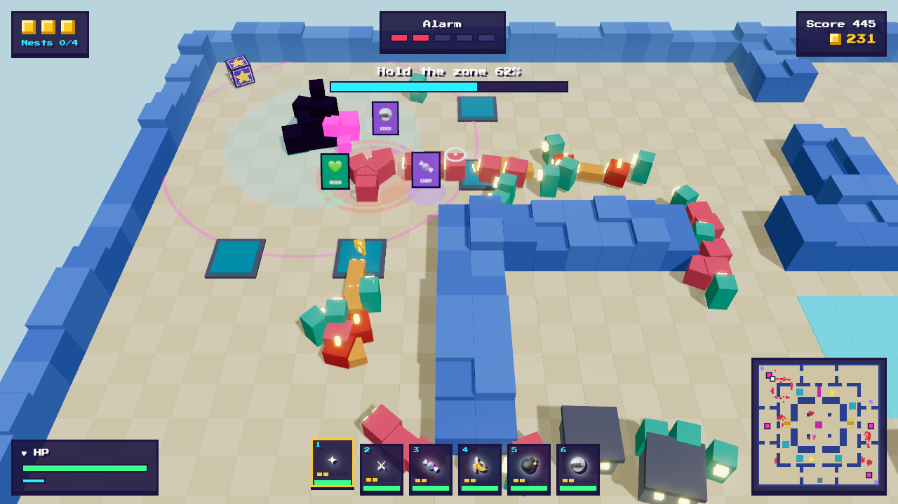
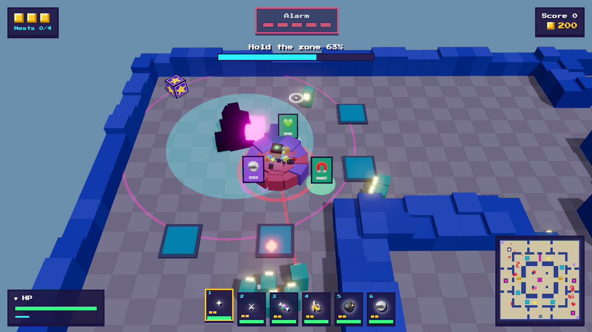

# Cube Crashers

**A fast voxel action game: fight your way up a tower, floor by floor.** Every floor is a big voxel map with
branching paths where hordes of retro arcade monsters roam and hunt you. The hordes come from glitch nests.
Plant a charge on a nest and hold the zone while the horde storms in, build towers at the chokepoints, jump
on monsters, dash through them, or grab a Crash Kart and plough through the pixels. Destroy every nest, then
reach the elevator. You have three credits.

> **Status: Tower Run, Stage 1 (one floor, single player).** Playable and balanced against a scripted bot;
> play-testing is ongoing. See the [roadmap](#roadmap).

| Holding a nest | Overload at alarm 5 |
|---|---|
|  |  |

Runs on **Windows and macOS**. Single player first; **LAN co-op for up to 6 players** comes later.

---

## Contents

- [How a run works](#how-a-run-works)
- [Controls](#controls)
- [Weapons, perks, towers, kart, power-ups](#weapons-perks-towers-kart-power-ups)
- [Monsters](#monsters)
- [Look and sound](#look-and-sound)
- [Run logs](#run-logs)
- [Getting started (development)](#getting-started-development)
- [Project structure](#project-structure)
- [Architecture](#architecture)
- [Building the desktop app](#building-the-desktop-app)
- [Roadmap](#roadmap)
- [Contributing](#contributing)
- [License](#license)

---

## How a run works

- **Goal:** each floor has **4 glitch nests** (picked at random from 7 spots, so every run is different).
  Destroy all of them and the **elevator** opens. Step in to clear the floor.
- **Destroying a nest:** walk up to it and **hold E for one second** to plant a charge. Then **hold the zone**
  (6 tiles around the nest) for 25 seconds:
  - Rush hordes storm in from the approaches. That is where the build pads are, so put towers there.
  - The nest fights back: a red ring marks where it will blast next, right under your feet. **Keep moving.**
  - If you leave the zone, the counter slowly runs back down, but the charge stays planted.
  - When it blows: a big explosion, a coin shower, a crate, and the alarm drops by one.
- **Credits:** you have **3 credits** per run. Going down costs one; you get back up after 3 seconds at the last
  safe point (the start, or the last nest you destroyed), lose 25 % of your coins and keep your weapons.
  When the last credit is gone, the run is over.
- **Alarm 0–5:** rises every 40 seconds. Every rise sends a horde hunting for you, and hordes get bigger and
  faster. At **alarm 5 (overload)** the lights go out and hunting parties keep coming. Destroying a nest
  lowers the alarm.
- **Score:** every monster gives points times your **combo multiplier**. Kill and collect coins without a
  3-second break to build up the combo (×2 every 10 kills, up to ×10). Clearing the floor adds a bonus per
  credit left and for speed. The best 5 scores are kept.
- **Coins** disappear after 8 seconds, so go and get them. You spend them on towers.

## Controls

| Input | Action |
|---|---|
| Mouse | Aim (crosshair on the ground) |
| Left mouse button (hold) | Fire the selected weapon |
| `W` `A` `S` `D` / arrow keys | Move. On foot, `W` walks toward the crosshair (like a shooter); this can be switched off in Settings. In the kart the keys always steer by the screen. |
| `1`–`6` / mouse wheel | Select a weapon |
| `Space` | Jump; landing **stomps** everything around you |
| `Shift` | **Dash**: short, invulnerable, damages what you pass |
| `E` (tap) | Get in / out of a kart |
| `E` (hold) | Plant a charge at a nest · open the build menu on a pad, then `1`–`3` for a tower |
| `Esc` / `P` | Pause |
| `F11` | Fullscreen (desktop app) |

Every weapon **reloads on its own, also when it is not selected**. The weapon bar shows each reload and
glows when a weapon is ready, so you can switch through and fire whatever is loaded.

## Weapons, perks, towers, kart, power-ups

### Weapons (up to 6, each up to level 5)

| Weapon | What it does |
|---|---|
| **Pixel Blaster** | Starter weapon. Fast bolts; more bolts at higher levels. |
| **Laser Sword** | Wide swing toward the crosshair. |
| **Candy Cannon** | Spread of candy pellets. |
| **Hotdog Slinger** | Lobs a hotdog to the crosshair; the mustard puddle keeps hurting. |
| **Joystick Boomerang** | Flies out and back, hitting everything twice. |
| **Disco Ball** | Zaps the nearest monsters around you. |
| **Banana Mine** | Drops a mine that blows up when a monster steps on it (up to 5). |
| **Party Bomb** | Lobs a big bomb to the crosshair. |

Hits from up close (within 3 tiles) deal **50 % more damage**.

### Crates and perks

Crates lie around the floor and drop from nests and elite monsters. Walk into one and it opens into **three
floating cards**: a new weapon, a weapon level-up or a perk. Walk into the card you want. The game does not
pause. Perks: **Speed**, **Extra Dash**, **Magnet**, **Coin Bonus**, **Regeneration**, **Big Stomp**.

### Towers

| Tower | Cost | What it does |
|---|---|---|
| **Laser Tower** | 12 | Fast single-target laser. |
| **Popcorn Mortar** | 20 | Lobs shells that hit everything in an area. |
| **Frost Machine** | 15 | Slows monsters to half speed. |

### Crash Kart

Two karts are parked on every floor. Tap `E` to get in. Twice as fast as walking, rams monsters out of the
way (40 damage), keeps your weapons firing, and protects you: hits damage the kart instead of you. Boost pads
speed you up, ramps launch you over low walls (the landing hurts everything around). It has 20 seconds of fuel
and 100 durability; when either runs out it bursts into cubes and comes back 45 seconds later.

### Power-ups

Every 30 seconds one appears somewhere on the map (shown on the minimap) for 15 seconds: **Coin Magnet**,
**Rapid Fire**, **Screen Bomb**, **Deep Freeze**, **Heart**.

## Monsters

All monsters are original voxel creatures in the style of old arcade games. Every dangerous attack is
announced first.

| Monster | Behaviour | Warning |
|---|---|---|
| **Hop Blob** | The standard horde monster. | – |
| **Hunter** | Fast, goes straight for you. | – |
| **Armor Block** | Slow and very tough. | – |
| **Splitter** | Splits into two small splitlings. | – |
| **Shooter** | Keeps its distance and fires slow red bullets. Jump over them. | Aim line on the ground |
| **Bomber** | Runs at you and blows up. Shooting it first makes it explode among its friends. | Blinking fuse, red ring |
| **Rammer** | Charges in a straight line and gets stunned if it hits a wall. Step aside. | Red lane on the ground |
| **Elite** | Any monster, bigger and glowing, five times the health. Drops a crate. | Magenta ring |

Hordes wander between waypoints until they see you, then the whole group hunts you down.

## Look and sound

- Bright voxel world by day; at **alarm 5** it switches to the night look with glowing monsters.
- Readability comes first: effects must never blur the gameplay.
- **All sound is synthesized in code** with the Web Audio API: an effect for every weapon, monster warning,
  explosion, combo step, kart and pickup, plus menu, battle and overload music. No audio files, no licensing
  issues.

## Run logs

After every run the game writes a small JSON log (result, score, time, kills by source, best combo, damage,
how much of the time you stood still, and a sample every 10 seconds). It never leaves your machine:

- Dev server: `logs/run-<time>.json` in the project folder (git-ignored).
- Desktop app: the `runs/` folder in the app's user data folder.
- Always: the last 20 runs in the browser's local storage.

## Getting started (development)

Requirements: [Node.js](https://nodejs.org/) 20 or newer.

```bash
git clone https://github.com/dominikamann/cube-crashers.git
cd cube-crashers
npm install

npm run dev     # run the game in the browser with hot reload (http://localhost:5173)
npm test        # run the test suite (Vitest)
npm run build   # type-check and build to dist/
```

Dev shortcuts (append to the URL):

| URL parameter | What it does |
|---|---|
| `?seed=7` | Fixed run layout |
| `?demo=1` | Start with six weapons and 200 coins |
| `?demo=nest&alarm=5` | Start next to a planted nest (optionally at a given alarm level) |
| `&warp=600` | Fast-forward the simulation by that many ticks (60 = 1 s) |
| `?sound=1` | Soundboard: play every sound effect and music track |

## Project structure

```
cube-crashers/
  src/
    sim/              pure game logic (no graphics, no DOM): state, systems, config tables
      map/            tile map, collision, line of sight, flow field
      config/         data tables: floor01 map, enemies, weapons, towers, perks, balance values
      systems/        player, enemies, hordes, nests, weapons, combat, coins, offers (crates/cards),
                      towers, vehicles, power-ups, stats, outcome
      sim.ts          createSim / stepSim: one fixed 60 Hz tick
    render/           Three.js: tile world, day/night themes, instanced monsters, actors, pickups, effects
    audio/            synthesized sound effects, chiptune music, mixer
    input/            keyboard and mouse → commands
    ui/               HUD, minimap, build menu, screens
    i18n/             all player-visible text (English; German planned)
    runlog.ts         run log building and saving
    loop.ts           fixed-step game loop
    main.ts           wires everything together
  electron/           desktop app main process and preload
  scripts/            build helpers (app icon generator)
  tests/              Vitest tests (incl. a scripted bot that plays whole floors)
  docs/
    superpowers/specs/   design documents
    superpowers/plans/   implementation plans
    design/              visual style reference and screenshots
    ideas.md             ideas for later
```

## Architecture

The most important rule: **game logic and presentation are strictly separated.**

```
 keyboard + mouse ──► Command[] ──► stepSim(state, commands)  (60 Hz, deterministic, seeded RNG)
                                          │
                                          ├──► SimState   ──► renderer (reads only)
                                          └──► SimEvent[] ──► renderer effects, sound, HUD, run log
```

- `src/sim/` never imports Three.js or the DOM, and never uses `Math.random` or `Date`. A test enforces this.
- The world is a tile grid parsed from a text map. Monsters find their way with a flow field toward the
  players that is rebuilt four times a second.
- **Why:** in the LAN version, the host runs the same simulation and sends the state to the other players,
  without rewriting game logic.
- Balancing lives in plain data tables in `src/sim/config/`. A scripted bot (`tests/sim/bot.ts`) plays whole
  floors in the tests to check that a floor can be won, cannot be won by standing still, and keeps the
  player moving.

## Building the desktop app

```bash
npm run app:dev    # run as a desktop app with hot reload
npm run app        # build and run the desktop app
npm run dist:mac   # build .dmg files for macOS (Apple Silicon + Intel) into release/
npm run dist:win   # build a Windows installer (.exe) into release/ (works from macOS too)
npm run icon       # regenerate the pixel-art app icon (build/icon.png)
```

Builds are currently **unsigned**:

- **macOS:** the first time, right-click the app → *Open* → *Open*.
- **Windows:** click *More info* → *Run anyway* on the SmartScreen warning.

## Roadmap

- [x] Phase 1 prototype (lane defence) – replaced, see [docs/ideas.md](docs/ideas.md)
- [x] **Tower Run Stage 1:** one big floor, nests with plant-and-hold, alarm, credits, roaming hordes,
      shooter/bomber/rammer/elites, manual aiming with 8 weapons, jump/stomp, dash, combo, crates with
      three-card choices and perks, towers, Crash Kart with boost pads and ramps, power-ups, minimap,
      score and local best list, run logs
- [ ] Play-testing and balancing
- [ ] **Stage 2:** a run over 5 floors with different themes, a shaft ride between floors (shoot swarms from
      the moving elevator), an elevator shop, boss floors (Mega Block, Segment Worm)
- [ ] **Stage 3:** unlocks, more vehicles, endless mode
- [ ] **LAN co-op for up to 6 players** (server built into every install, games found automatically)
- [ ] German translation
- [ ] Ideas for later ([docs/ideas.md](docs/ideas.md)): real-city maps from OpenStreetMap, plugins

## Contributing

Contributions are welcome. Please keep in mind:

- **All assets must be original or freely licensed.** Sounds and music are synthesized in code; graphics are
  built from voxels in code.
- **No protected characters, names or brands.** Monsters are original creatures *in the style of* old
  arcade games.
- Game logic belongs in `src/sim/` and must stay pure and deterministic.
- Write tests first (`npm test`) for game logic changes.
- All player-visible text goes through `t()` in `src/i18n/`.

## License

[MIT](LICENSE) © 2026 Dominik Amann. Third-party assets (the pixel font) are listed in
[LICENSE-ASSETS.md](LICENSE-ASSETS.md).
