# Cube Crashers

[](https://github.com/dominikamann/cube-crashers/releases/latest)
[](https://github.com/dominikamann/cube-crashers/releases)
[](https://amannlabs.itch.io/cube-crashers)


[](LICENSE)
[](https://github.com/sponsors/dominikamann)

**A fast voxel action game for one to ten players.** Fight your way up a tower, floor by floor. Hordes of
retro arcade monsters (blobs, crocodiles, monkeys, a T-Rex, sharks and more) roam a big voxel map and hunt you
down. Blow up their glitch nests, hold the zone while the horde storms in, build towers at the chokepoints,
stomp, dash, fly a jetpack over the walls, ride a Crash Kart or a lucky unicorn. Every run picks its worlds,
from the Arcade Plaza to the Pixel Jungle, the Server Farm and the Sunken Arcade with the Kraken. Play alone,
with up to nine friends on your LAN or online, together against the monsters or against each other in
**Versus**: score races, King of the Cube, Capture the Cube, Gun Game, Coin-Op Chaos, from above or in
**first person** like a classic shooter. Plus a **Boss Rush** and a **Daily Run**.

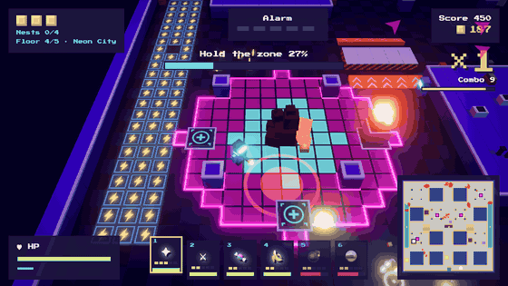

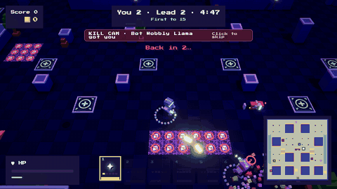

<table>
  <tr>
    <td>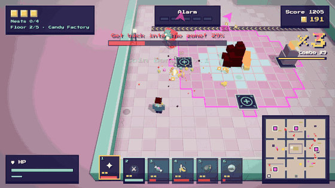</td>
    <td>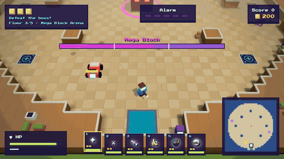</td>
  </tr>
  <tr>
    <td align="center"><sub>Candy Factory: conveyor belts push everyone around</sub></td>
    <td align="center"><sub>Mega Block Arena: the first boss</sub></td>
  </tr>
  <tr>
    <td>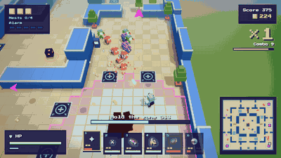</td>
    <td>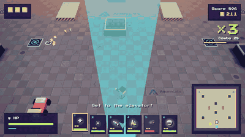</td>
  </tr>
  <tr>
    <td align="center"><sub>Arcade Plaza: hold the zone while the hordes storm in</sub></td>
    <td align="center"><sub>Rooftop: the Segment Worm splits when you hit its middle</sub></td>
  </tr>
  <tr>
    <td>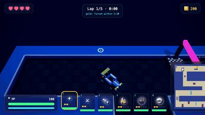</td>
    <td>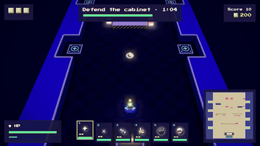</td>
  </tr>
  <tr>
    <td align="center"><sub>Kart Rally: first to five laps wins</sub></td>
    <td align="center"><sub>Lane Defense: keep the arcade cabinet alive</sub></td>
  </tr>
  <tr>
    <td>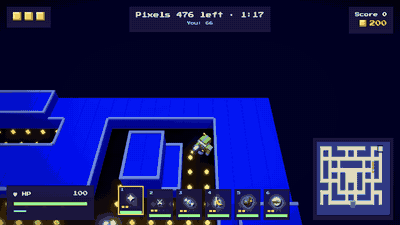</td>
    <td>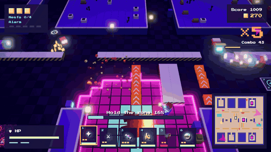</td>
  </tr>
  <tr>
    <td align="center"><sub>Glitch Maze: no weapons, just you, the pixels and the ghosts</sub></td>
    <td align="center"><sub>Neon Highway: boost lanes, jumps, nests under the overpasses</sub></td>
  </tr>
</table>

Runs on **Windows and macOS**; a [browser version](https://amannlabs.itch.io/cube-crashers) lets you try it first. Free and open source (MIT).

---

## Contents

- [Download and install](#download-and-install)
- [How to play](#how-to-play)
- [The run: five floors, a different game between them, shop, bosses](#the-run-five-floors-a-different-game-between-them-shop-bosses)
- [Boss Rush](#boss-rush)
- [Daily Run](#daily-run)
- [Unlocks and endless mode](#unlocks-and-endless-mode)
- [Settings and graphics](#settings-and-graphics)
- [Playing together on the LAN](#playing-together-on-the-lan)
- [Online Multiplayer and dedicated servers](#online-multiplayer-and-dedicated-servers)
- [Versus: players against players](#versus-players-against-players)
- [First-person view](#first-person-view)
- [Controls](#controls)
- [Weapons, rare weapons, jetpack, perks, towers, kart, power-ups](#weapons-rare-weapons-jetpack-perks-towers-kart-power-ups)
- [Monsters](#monsters)
- [Difficulty](#difficulty)
- [Run logs](#run-logs)
- [Development](#development)
- [Architecture](#architecture)
- [Roadmap](#roadmap)
- [Contributing](#contributing)
- [License](#license)

---

## Download and install

**Recommended: the desktop app.** It is the full game, with LAN parties, every online server and the best
performance. Get the latest version from the
**[Releases page](https://github.com/dominikamann/cube-crashers/releases/latest)** (or from the itch.io page).

**Just want a quick look?** [Play in the browser on itch.io](https://amannlabs.itch.io/cube-crashers) without
installing anything: alone, in split screen or online on servers that take browser players.

### macOS

1. Download the `.dmg` that matches your Mac:
   - Apple Silicon (M1, M2, M3, M4 …): `CubeCrashers-<version>-mac-arm64.dmg`
   - Intel Mac: `CubeCrashers-<version>-mac-x64.dmg`
2. Open the `.dmg` and drag **Cube Crashers** into **Applications**. Start it from there.
   The Mac app is signed and notarized by Apple, so it opens without warnings.

### Windows

1. Download `CubeCrashers-<version>-win-x64.exe`.
2. Run it. Windows SmartScreen warns about an unknown publisher because the installer is not signed yet:
   click **More info → Run anyway**.
3. Choose the install folder and finish the setup. Start the game from the Start menu or the desktop.
4. **For LAN games:** when Windows asks whether Cube Crashers may use the network, allow it for **private
   networks**.

### Updates

The app checks GitHub for a new release when it starts (and every few hours).
- **Windows:** the update downloads in the background; a banner offers **Restart now**, otherwise it is
  installed the next time you quit.
- **macOS:** the same: the update downloads in the background and installs on restart. (Versions up to 0.3.4
  were not signed; if you have one of those, download 0.3.5 once by hand.)

### From the source code

See [Development](#development). You need Node.js 20 or newer.

---

## How to play

1. Start the game, pick a mode under **Play** and click it:
   - **Tower Run**: the full game over five floors.
   - **Single floor**: one map of your choice, a short game. Every world, the bosses and the three
     minigames (Kart Rally, Lane Defense, Glitch Maze) are there to pick.
   - **Versus**: players against players, with bots to fill up (see [Versus](#versus-players-against-players)).
   - **Endless**: once unlocked (see [Unlocks](#unlocks-and-endless-mode)).
   - Under **Tower Run** you also find the **Daily Run** and the **Boss Rush**; **LAN party** and **Online
     Multiplayer** are next to the tiles.

   Set the **difficulty** with the arrows below.
2. You start next to the elevator at the bottom of the map. The **minimap** (bottom right) shows the
   **glitch nests** (big pulsing pink squares), karts (yellow), power-ups (white), crates (purple) and the
   elevator. Arrows at the screen edge point to the nearest nests, and each nest has a pink light beam.
3. **Destroy every nest:**
   - Walk up to a nest and **hold E for one second** to plant a charge (a bar shows the progress). The nest
     turns red and starts shaking.
   - Now **hold the zone** for 25 seconds: the floor tiles around the nest, framed in pink. They light up
     one by one as you hold it. Hordes storm in from the approaches, so build **towers** on the pads nearby.
   - The nest fights back: a red ring marks where it will blast next, right under your feet. **Keep moving.**
   - If you leave the zone, the counter slowly runs back, but the charge stays.
4. When all nests are gone the **elevator opens**. Step in to clear the floor and ride up to the next one.

After the last floor (or a lost run) the **result screen** shows every player: score, monsters crashed, their
best weapon, best combo, towers built, coins collected, revives and downs.

**Things to know:**
- You have **3 credits** (depends on the difficulty). Going down costs one; you get back up at the last safe
  spot. Out of credits = game over.
- The **alarm** (top centre) rises every 40 seconds and sends hordes after you. At alarm 5 the lights go out.
  Destroying a nest lowers it.
- **Coins** drop from monsters and vanish after 8 seconds. Spend them on towers, upgrades and in the shop.
- **Yellow-black barriers** stop you on foot: **jump** over them (Space). The orange **ramps** in front of them
  launch a kart over.
- **Glitch floor** (purple, with a crossed-out monster) stops monsters but hurts you. Jump over it.
- **Boost pads** (blue with a lightning bolt) make karts faster.
- **Combo:** keep killing without a 3-second break. The multiplier (up to ×10) boosts coins and score.
- **Crates** open into three cards: pick a new weapon, a weapon level-up or a perk by walking into it. Very
  rarely a **golden card** gives you a rare weapon for 60 seconds.

---

## The run: five floors, a different game between them, shop, bosses

| Floor | Theme | What happens | Then |
|---|---|---|---|
| 1 | Arcade Plaza | Nests, daylight | **Kart Rally** |
| 2 | Candy Factory *or* Pixel Jungle | Nests; **conveyor belts** and gumball machines for cover in the factory; **tall grass** in the jungle hides monsters until they are close, crocodiles and monkeys live there | **Lane Defense** |
| 3 | Mega Block Arena *or* Sunken Arcade | **Boss: Mega Block**, or under water **the Kraken** with fish and sharks | **Glitch Maze** |
| 4 | Neon City, Neon Highway *or* Server Farm | Nests; permanent night, more elites; in the server farm cooling fans blow you along the aisles | **Shaft ride** |

Which world each floor is depends on the run (its seed), so no two runs look quite the same; on the LAN
everyone gets the same ones. Every world can also be played on its own under **Single floor**.
| 5 | Rooftop | **Final boss: Segment Worm** | – |

Between the floors the elevator takes you to a short game of its own, then to the shop:

- **Kart Rally:** everyone sits in their own kart (no getting out, and it cannot be wrecked) on a race track with a
  jump, boost pads, an S-bend and a narrow canyon. **The first to drive five laps wins**, and the race ends right
  then. Laps only count through every checkpoint in order. Ram or shoot the monsters on the track. Alone you drive
  for a medal by your time (gold within 1:20, silver within 1:45, bronze within 2:30).
- **Lane Defense:** one long lane, your arcade cabinet at the bottom. Hold it for 90 seconds while the waves
  march down. Every monster that reaches the cabinet damages it; what is left of it pays coins, a perfect
  defence pays extra. Build pads line the lane, coins and power-ups wait further up.
- **Glitch Maze:** no weapons, no jumping. Collect the pixels in the maze while the glitch ghosts hunt you; a
  caught player goes back to the start (no damage, no credit lost). A power cube in each corner turns the
  ghosts blue for a few seconds: crash them for coins. Clear the maze for a bonus.
- **Shaft ride:** you stand on the elevator platform for 45 seconds while flying **glitch swarmers** attack from
  every side. Keep shooting.
- **Elevator shop:** then the elevator stops. Everyone gets four offers: a weapon level-up, a perk, a full heal,
  or +1 credit for the team (expensive, once per shop). Buy with **1–4** or a click, press **Enter** when you
  are ready. The shop closes after 25 seconds or when everyone is ready.
- **Mega Block:** a huge armoured block with three phases. It stomps (red rings), sends shockwaves along lines
  and calls reinforcements. Get out of the marked areas.
- **The Kraken:** crawls slowly across the sea bed toward you on eight long tentacles. Up close it slaps them
  down in a ring around itself; from further away it slams them down in lines, bursts ink clouds under everyone,
  or grabs a player with a tentacle and drags them in (dash to break free). Schools of fish and sharks swim
  about from the start, the Kraken keeps calling new ones, faster each phase, and a big school at each new phase.
- **Segment Worm:** a long worm of segments. Shoot it in the middle and it splits into two worms (up to four).
  Its strikes are marked on the ground first.
- The **Segment Worm is the final boss**. Bosses shrug off stomps and kart rams (a quarter of the damage), so bring your weapons.
- Weapons, perks, coins and credits come with you to the next floor. Towers, karts, monsters and the alarm start
  fresh. Beat the Segment Worm and take the last elevator to win the run.

---

## Boss Rush

Also under **Tower Run**: every boss in a row, with a shop between them: **Mega Block**, the **Segment Worm**,
**the Kraken** and, at the end, **King Rex**, a T-Rex grown to boss size that roars, cracks the ground in a
ring around itself and stomps under everyone. At the difficulty you set; its own best list.

## Daily Run

Under **Tower Run** there is a **Daily Run**: once a day the same tower for everyone in the world (same seed, so
the same floors, crates and rare weapons), on Medium with every weapon unlocked. Your five best scores of the day
are kept; tomorrow there is a new one. Compare with friends.

## Unlocks and endless mode

Beating the Tower Run unlocks **Endless mode** right away. After every run you earn **tickets** (from your score, the floors you cleared and the difficulty). Spend them
under **Unlocks** on the title screen:

| Unlock | What it is |
|---|---|
| Joystick Boomerang, Disco Ball, Banana Mine, Party Bomb | Weapons that are locked at the start and then show up in crates |
| **Steamroller** | Slow, very tough, crushes everything it touches; no ramp jumps |
| **Hoverboard** | Fast, floats over glitch floor and low walls, fragile, does not ram |
| **Endless mode** | Arcade Plaza without an end: destroyed nests come back elsewhere after 60 seconds and the alarm keeps climbing. Own high score list. |

Progress is saved on your computer. On the LAN, everything any player in the lobby has unlocked is available to
the whole team.

---

## Settings and graphics

- **Mouse speed (first person):** how fast the mouse or touchpad turns the view, 0.5× to 3×. On a touchpad try 2× or 3×.
- **Graphics quality:** Low, Medium, High (default) or Ultra. Higher levels use sharper shadows, smoothing,
  glow, colour grading and (Ultra) ambient occlusion. Pick Low on older laptops.
- **Damage numbers:** floating numbers when you hit something (can be switched off).
- **Suit colour:** pick one of six colours or *automatic*. On the LAN you get it if nobody else has it.
- **Your name**, sound and music volume, and whether `W` walks toward the crosshair (Counter-Strike style, off by default).
- **Keys → Change keys** opens the **Controls** page: every keyboard action with its key. Click an action (or pick it
  and press `Enter`), then press the new key. If another action had that key, the two swap. *Reset to defaults*
  brings back the standard keys. `Esc` and `P` always pause and cannot be changed; the mouse buttons and the
  controller keep theirs. All hints in the game (build pad, build menu, emote bar, tips) name your keys.
- **Colour-blind mode** (off by default): nothing important relies on telling red from green any more. Teams are
  orange ▲ against blue ● with the shape over every player, on the minimap and in the team names; health bars run
  from light blue to dark orange and get darker as health drops; monster shots are violet and bigger than your
  yellow bolts; angry eyes and warning lanes and rings blink hard; the glitch floor shows a thick yellow "no" sign.
  It switches at once, also in a paused match.
- **Controls** are listed at the bottom of the settings screen, and **About** shows the version you have installed.
- **Credits** (title screen): who made the game.

---

## Playing together on the LAN

Up to **10 players** on the same network (Wi-Fi or cable), all with the desktop app.

**One player hosts:**
1. *Settings → Your name*: enter a name (it is shown to the others).
2. Click **LAN party → Host LAN game**. Your game shows up on the network automatically.
3. In the lobby:
   - **Co-op**: **Co-op run** starts the Tower Run together; the difficulty sits right next to it.
   - **Versus**: **Versus…** opens the match setup (start it right away or **Let everyone vote** between two
     matches for 30 seconds). **N players with bots** fills every match up with bots; friends who join take
     a bot's place.
   - **View**: *Both* (everyone switches with V), *First person* only or *Top view* only, for everyone.

**Everyone else joins:**
1. Enter a name in *Settings* as well.
2. Click **LAN party → Join LAN game**. Games on your network appear in a list after a moment; click one.
3. If no game shows up (some routers block it), type the host's address into the field, e.g. `192.168.1.20`.
   The host finds it in the system network settings.

**In the game:**
- Every player has their own **suit colour**, weapons, perks and coins. **Credits belong to the team.**
- When a teammate goes down, they lie on the floor for **8 seconds**. Stand next to them and **hold E** to help
  them up: no credit lost. If nobody makes it in time, the team loses a credit.
- Hordes grow with the number of players. Split up and hold several nests at once.
- After the run a **ranking** shows who crashed the most cubes, the best combo, and who helped others up most.

Technical details: the host's game runs the match and sends the state to everyone 30 times per second over
TCP port **47800**; games are announced via UDP broadcast on port **47801**. Only the local network is used.

---

## Online Multiplayer and dedicated servers

**Playing:** click **Online Multiplayer** on the title screen. The list shows the servers from the shared
[`servers.json`](servers.json) and the ones you added yourself. It works in the desktop app and in the
browser; in the browser the list only has the servers that [take browser players](#let-players-from-the-browser-join):

- Servers you can join come first (most real players first), with their mode, ping and who is on them,
  bots counted apart: *10/10 players (6 bots)*. A real player who joins takes a bot's place.
- Servers on another version say so (e.g. *other version (v0.4.3)*), offline ones are greyed out at the end.
- **Add a server**: type its address, e.g. `10.12.3.23` or `play.example.org:47800`. It is remembered on
  your computer; the ✕ removes it again.
- The list is loaded from GitHub while it is open and every server is asked again every 10 seconds, so new
  servers show up without a new release of the game.

On a server you land in its lobby. The next match starts after a countdown, or right away once everyone
clicked **I am ready**. After a match the results show for a few seconds, then everyone is back in the lobby
for the next one (Gun Game and the other rules move on to a new arena each time).

### Run your own server

The server is a small program without graphics. Pick one way:

**Docker** (recommended):

```bash
docker run -d --name cube-crashers -p 47800:47800 --restart unless-stopped \
  ghcr.io/dominikamann/cube-crashers-server --name "My Server" --mode gungame
```

**Node.js 20 or newer**: download `cube-crashers-server.mjs` from the
[latest release](https://github.com/dominikamann/cube-crashers/releases/latest) and run

```bash
node cube-crashers-server.mjs --name "My Server" --mode discovery
```

**From the source code**: `npm install`, then `npm run server -- --mode score --teams`.

| Option | What it does | Default |
|---|---|---|
| `--name <text>` | Name in the server list | Cube Crashers Server |
| `--port <number>` | Port the server listens on | 47800 |
| `--mode <mode>` | `discovery` (all rules in turn), `gungame`, `coinop`, `score`, `king`, `rounds`, `capture` or `coop` (the Tower Run) | discovery |
| `--map <arena>` | Always this arena: `neon`, `highway`, `floor01`, `candy`, `arena`, `rooftop` | a new one each match |
| `--teams` | Red against Blue for `score`, `king`, `rounds`, `coinop` (`capture` is always teams) | off |
| `--bots <0-10>` | Bots fill every versus match up to this many players | 4 |
| `--difficulty <level>` | Co-op floors, and how well the versus bots play: `ultraLow`, `low`, `medium`, `high`, `ultraHigh` | medium |
| `--view <view>` | `both`, `fp` (first person only) or `top` (from above only) | both |
| `--countdown <seconds>` | Wait this long for players before a match | 30 |
| `--monsters` | Monster hordes join versus matches | off |
| `--web` | Players from the browser version may join (see [below](#let-players-from-the-browser-join)) | off |
| `--config <file>` | Read the options from a JSON file | `./server.json` if it exists |

Every option also works as an environment variable (`CC_MODE=gungame`, `CC_BOTS=6`, …), handy with Docker.
A config file looks like this:

```json
{ "name": "Gun Club", "mode": "gungame", "bots": 6, "view": "fp" }
```

**Keep it up to date:** players can only join a server that runs the same version as their game (the list
says *other version* otherwise). With Docker: `docker pull ghcr.io/dominikamann/cube-crashers-server` and
restart the container; with Node: download the new `cube-crashers-server.mjs` from the latest release.

To play over the internet, **open the port (TCP 47800) in your router** and forward it to the computer
running the server. Players on your own network can use its local address.

### Let players from the browser join

The game also runs in the browser. A web page served over https may only open encrypted connections, so
browser players cannot reach port 47800 directly. Two steps open your server to them:

1. Start the server with **`--web`** (or `CC_WEB=1`). Without it the server turns away every connection
   that comes from a web page.
2. Put a **TLS proxy** with a domain name in front of it. With [Caddy](https://caddyserver.com) that is a
   `Caddyfile` of three lines; Caddy fetches the certificate by itself (the domain must point to your
   server and ports 80 and 443 must be open):

   ```
   play.example.org {
       reverse_proxy localhost:47800
   }
   ```

Browser players then add `play.example.org` under **Add a server** (without a port the browser uses 443).
Players with the desktop app keep using port 47800, on the same server and in the same matches.

### Get your server into the list

Open a pull request that adds it to [`servers.json`](servers.json). `address` is where the desktop app
connects; `web` is the address for browser players, if your server takes them (leave it out otherwise):

```json
{
  "servers": [
    { "name": "Gun Club", "address": "play.example.org:47800", "web": "play.example.org" }
  ]
}
```

Once it is merged, every game shows it the next time the list is opened.

---

## Versus: players against players

From the title (**Versus**, with bots) or in the LAN lobby (**Versus…**). Everyone starts with the Pixel
Blaster; crates with weapons, karts and a jetpack lie around. Up to 10 players, bots fill up. Pick how well the
bots play, from **Ultra Low** (they aim wide and shoot late) to **Ultra High** (sharp and instant).

| Rule | How it works |
|---|---|
| **Score Race** | Respawn after 3 seconds. First to 15 kills (teams: 30) wins, or the most after 5 minutes. |
| **Last Cube Standing** | No respawn within a round; the last one (or team) standing wins it. 4 rounds win the match. |
| **King of the Cube** | A glowing zone moves around the map. A point per second while you hold it alone. |
| **Capture the Cube** | Red vs Blue. Steal the other cube and carry it home while yours is at home. Carriers are slow and cannot fly. |
| **Gun Game** | One weapon at a time: every kill moves you up the ladder (Blaster → Candy Cannon → Hotdog → Boomerang → Pixel Rail → Bomb → Disco Ball → Laser Sword → **Fly Swatter**). A kill with the swatter wins, then the next match moves to a new map. Getting swatted costs you a step. |
| **Coin-Op Chaos** | A score race where a random rule changes every 30 seconds: *turbo* (everyone runs faster), *moon* (long floaty jumps), *rapid fire*, *swords only*, *boom* (whoever goes down explodes) or *double damage*. |

- **Free for all** or **Red vs Blue** (teams are evened out; on the LAN everyone can wish for a team).
- **Monsters roam too**: hordes join the fight now and then.
- **Discovery**: a new match every time, through every rule, teams and free for all taking turns, a new map,
  now and then monsters. The default.
- Towers have an owner and fire at rivals, but only at a third of their strength.

**Kill cam:** knocked out by a rival, you watch the last seconds again from their side while you wait to come
back (a click skips it; *Settings → Kill cam* switches it off).

## First-person view

Press **V** (controller: **View**) to switch between the view from above and first person. Versus starts in
first person. The mouse turns and tilts the view (it is captured; **Esc** pauses and frees it), on a controller
the right stick. **W** walks where you look. You see your weapon in hand; hotdogs and bombs land where the
crosshair meets the ground, with a marker. In a kart you sit behind the wheel, on a hoverboard you see its nose.
Health bars over monsters and other players show at a glance whether you hit. If the mouse was outside the
window when you pressed V, the game cannot capture it: *Click to aim* appears, and one click fixes it.

---

## Controls

| Input | Action |
|---|---|
| Mouse | Aim (crosshair on the ground) |
| Left mouse button (hold) | Fire the selected weapon |
| `W` `A` `S` `D` / arrow keys | Move: `W` is up the screen, the mouse only aims (*Settings → Walking* switches to "toward the crosshair"). In first person `W` walks where you look. |
| `V` | First person on / off (mouse turns and tilts the view) |
| `1`–`6` / mouse wheel | Select a weapon |
| `Q` | Select the rare weapon (when you have one) |
| `Space` | Jump over barriers and glitch floor; landing **stomps** everything around you. **Hold** to fly when you carry a jetpack. |
| `Shift` | **Dash**: short, invulnerable, damages what you pass |
| `E` | Get in / out of a kart · on a pad: open the towers, `E` again builds the selected one (mouse wheel or `1`–`5` to choose), hold to build it right away |
| `E` (hold) | Plant a charge · help a teammate up · finish or repair a tower |
| `1`–`4`, `Enter` | In the elevator shop: buy an offer, say you are ready |
| `Esc` / `P` | Menu (pauses when playing alone) |
| `Z` | Zoom out / in |
| `M` | Show or hide the minimap (in first person it is smaller and see-through anyway) |
| `C` | Quick messages: then `1` Help! · `2` Over here! (at the crosshair) · `3` Nest here! · `4` Need coins! · `5` Nice! · `6` GG |
| Middle mouse button | Ping: "Over here!" at the crosshair, for everyone |
| `F11` | Fullscreen (desktop app) |

These are the default keys: change them under *Settings → Keys → Change keys*. The arrow keys, right `Shift` and
the number pad keep working alongside your keys unless you give them another job.

### Controller (Xbox and other standard pads)

Connect it and press any button; it takes over as soon as you touch it. It also works in the menus (d-pad or
stick to choose, **A** to confirm, **B** to go back).

| Button | Action |
|---|---|
| Left stick | Move |
| Right stick | Aim; the view slides ahead the further you push (all the way also fires). In first person: turn and tilt |
| `View` (Back) | First person on / off |
| `R3` (press the right stick) | Zoom out / in |
| `RT` | Fire |
| `A` | Jump; hold to fly with a jetpack |
| `B` | Dash · close the build menu |
| `X` | Like `E`: kart, open the towers on a pad and build the selected one, hold to plant, repair, help up |
| `Y` | Rare weapon |
| `LB` / `RB` | Previous / next weapon · in the build menu: choose the tower |
| D-pad | Quick messages: ▲ Help! · ▶ Over here! (ping at the crosshair) · ◀ Nice! · ▼ GG · build menu: ◀ ▶ choose the tower · shop: buy offers 1–4 |
| `Start` | Pause |

PlayStation pads (PS4, PS5) and other standard controllers work the same way; the hints then show □ instead
of X. On a PlayStation pad: ✕ = A, ○ = B, □ = X, △ = Y, L1/R1 = LB/RB, R2 = RT, Options = Start.
If a controller acts strangely, open the game with `?paddebug=1` (browser) to see what it reports.

### Split screen (two players on one computer)

On the title screen choose **2 players · split screen**. With one controller, player 1 plays with keyboard and
mouse and player 2 with the controller. With two controllers each player has one. Each half has its own
camera, HUD and crosshair in the player's suit colour.

Every weapon **reloads on its own, also when it is not selected**. The weapon bar shows each reload and
glows when a weapon is ready, so you can switch through and fire whatever is loaded.

---

## Weapons, rare weapons, jetpack, perks, towers, kart, power-ups

### Weapons (up to 6, each up to level 5)

| Weapon | What it does |
|---|---|
| **Pixel Blaster** | Starter weapon. Fast bolts; more bolts at higher levels. |
| **Laser Sword** | Wide swing toward the crosshair. |
| **Candy Cannon** | Spread of candy pellets. |
| **Hotdog Slinger** | Lobs a hotdog to the crosshair: a ketchup burst on impact, then sticky mustard that slows and hurts. |
| **Joystick Boomerang** | Flies out and back, hitting everything twice. |
| **Disco Ball** | Zaps the nearest monsters around you (up to 7 tiles, in versus rivals too), no aiming needed. |
| **Banana Mine** | Drops a mine that blows up when a monster steps on it. |
| **Party Bomb** | Lobs a big bomb to the crosshair. |
| **Pixel Rail** | An instant beam through every monster in a line, until the first wall. Slow to reload, hits hard. |
| **Fly Swatter** | A huge slap swung sideways right across your front: very strong, very short. The knife of this game. |
| **Bubble Wand** | A slow soap bubble: the monster it hits floats stuck in it for a few seconds. |
| **Magnet Glove** | Pulls the monsters in front of you together at the crosshair (then throw a bomb). Yanks rivals toward you. |
| **Yo-yo Launcher** | Out and straight back on its string, hitting on both ways. Short and quick. |

Hits from up close (within 3 tiles) deal **50 % more damage**.

### Rare weapons (golden cards, 60 seconds, key `Q`)

| Rare weapon | What it does |
|---|---|
| **Slush Machine** | Sprays icy slush. Monsters slow down and then freeze solid; frozen monsters take double damage. |
| **Bubblegum Bazooka** | Traps monsters in a huge gum bubble that pops after 3 seconds. |
| **Leaf Blower 3000** | Blows hordes away and slams them into walls. Blows coins toward you. |
| **Pizza Cutter** | A spinning saw that bounces off walls and cuts through everything. |

### Ladders

Every world (apart from the minigames) has a few ladders against the blocks. Walk into the wall at one and
you **climb onto the block**, the same perch the jetpack lands you on. Walk off the edge to drop down.

### Jetpack

Lies somewhere on the map now and then. Pick it up and **hold Space** to fly over walls, glitch floor and
monsters. The tank lasts about 5 seconds of flight and fills up again on the ground; you keep the jetpack
for the rest of the floor.

Let go of Space and you sink gently back down. Above a block inside the arena you **land on top of it**: monsters cannot reach you up
there and the tank fills up again. Walk off the edge to drop down. Shots still hit you, so in versus it is a
breather, not a fortress. (The outer walls of the map do not count.)

### Perks

**Speed**, **Extra Dash**, **Magnet**, **Coin Bonus**, **Regeneration**, **Big Stomp**.

### Towers

Stand on a pad and press **E** (controller: **X**): the towers open with the first one selected. Choose with
the mouse wheel, **1–5** or ◀ ▶, press **E** again to build it, or simply keep holding **E** to build the
selected one right away. You pay right away, then a scaffold goes up: keep **holding E** for about 2.5 seconds
until the tower stands. If you let go, it stays half-built and you can finish it later. A tower only fires
once it is finished. Towers are solid: you walk round them, and work on them from right beside them.

| Tower | Cost | Upgrade to level 2 / 3 | What it does |
|---|---|---|---|
| **Laser Tower** | 40 | 40 / 60 | Fast single-target laser. |
| **Frost Machine** | 50 | 50 / 75 | Slows monsters to half speed. |
| **Popcorn Mortar** | 60 | 60 / 90 | Lobs shells that hit everything in an area. |
| **Bumper** | 45 | 45 / 68 | Knocks monsters around it away like a pinball bumper (into walls, ouch). |
| **Tesla Coil** | 70 | 70 / 105 | Lightning that jumps from monster to monster, up to four in a row. |

- **Upgrade:** press E next to a finished tower and E again. Each level gives +50 % damage and health, +1 range
  and fires faster. The upgrade is built like a tower (3 seconds of holding E); the tower keeps firing
  meanwhile. Gold marks on the base show the level.
- **Repair:** hold E on a damaged tower. It heals a quarter of its health per second, for free.

### Crash Kart, Steamroller, Hoverboard, Unicorn

Tap `E` next to a kart to get in. Twice as fast as walking, rams monsters out of the way, keeps your weapons
firing and protects you: hits damage the kart instead of you. Boost pads speed you up, ramps launch you over
low walls. 20 seconds of fuel; comes back 45 seconds after it breaks. Once unlocked, the **Steamroller** and
the **Hoverboard** appear on the map as well (see [Unlocks](#unlocks-and-endless-mode)).

Now and then a **unicorn** trots in on its own ("A unicorn appeared!"). Ride it like a kart: faster than one,
it leaps off ramps, spears monsters with its horn and leaves a rainbow behind. It never runs out of steam, but
once it is wrecked it is gone until the next lucky moment.

### Power-ups

Every 30 seconds one appears somewhere (shown on the minimap): **Coin Magnet**, **Rapid Fire**,
**Screen Bomb**, **Deep Freeze**, **Heart**.

---

## Monsters

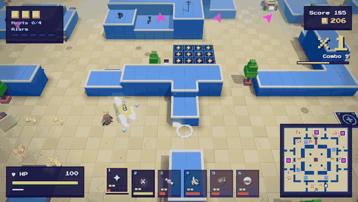

All monsters are original voxel creatures, built from many small cubes, with feet, arms, tails and wings that
move. Every dangerous attack is announced first: the eyes glow red, and the ground shows where it will hit.

| Monster | Behaviour | Warning |
|---|---|---|
| **Hop Blob** | The standard horde monster. | – |
| **Hunter** | Fast, goes straight for you. | – |
| **Armor Block** | Slow and very tough. | – |
| **Splitter** | Splits into two small splitlings. | – |
| **Shooter** | Keeps its distance and fires slow red bullets. Jump over them. | Aim line on the ground |
| **Bomber** | Runs at you and blows up. Shoot it first and it explodes among its friends. | Blinking fuse, red ring |
| **Rammer** | Charges in a straight line; stunned when it hits a wall. Step aside. | Red lane on the ground |
| **Glitch Swarmer** | Small and weak, flies over walls during the shaft ride. | – |
| **Shielder** | Holds a shield in front: shots from the front do little. Get behind it, or throw a bomb or hotdog over it. | Silver shield |
| **Healer** | Stays back and mends the monsters around it. Take it out first. | Green cross, green sparkles |
| **Teleporter** | Shimmers, then blinks right next to you. | It flickers before it blinks |
| **Crocodile** | Heavy and tough. Lunges a short way with a snap of its jaws. | Red lane on the ground |
| **Monkey** | Keeps its distance and throws coconuts that burst where you stood. | Red ring where it lands |
| **T-Rex** | The biggest of them all: roars, then stomps everything around it. Shows up once the alarm has risen. | Red ring around it |
| **Glitch Ghost** | Drifts straight through walls toward you; from afar you only see it flicker. | It flickers in and out |
| **Pixel Fish** | Small and fast, in schools (under water). | – |
| **Shark** | Under water: lunges at you with its jaws. | Red lane on the ground |
| **The Kraken** | Boss of the Sunken Arcade. Crawls, slaps, grabs and drags you in. | Marked lines and rings; dash out of its grip |
| **King Rex** | The last boss of the Boss Rush. | Red rings |
| **Mega Block** | Boss of floor 3. | Red rings, marked lines |
| **Segment Worm** | Boss of floor 5. Splits when hit in the middle. | Marked strike areas |
| **Elite** | Any monster, bigger and glowing, five times the health. Drops a crate. | Magenta ring |

---

## Difficulty

Chosen on the title screen (alone) or in the lobby (by the host).

| Level | Monster health | Monster damage | Horde size | Credits | Alarm speed | Points |
|---|---|---|---|---|---|---|
| Ultra Low | ×0.5 | ×0.35 | ×0.5 | 6 | half speed | ×0.5 |
| Low | ×0.75 | ×0.6 | ×0.75 | 4 | slower | ×0.75 |
| Medium | ×1 | ×1 | ×1 | 3 | normal | ×1 |
| High | ×1.25 | ×1.25 | ×1.2 | 3 | faster | ×1.5 |
| Ultra High | ×1.5 | ×1.5 | ×1.4 | 2 | much faster | ×2 |

On **Ultra Low** and **Low** you heal slowly (6 or 3 health per second) after 4 seconds without being hit.
On every level, a crowd of monsters around you hurts less than the sum of its members: the strongest one hits in
full, every further one at 30 %.

The best five scores are kept per difficulty; endless mode has its own list.

---

## Run logs

After every run the game writes a small JSON log (result, score, time, kills by source, best combo, damage,
how much of the time you stood still, and a sample every 10 seconds). It never leaves your computer:

- Desktop app: the `runs/` folder in the app's user data folder.
- Dev server: `logs/run-<time>.json` in the project folder (git-ignored).
- Always: the last 20 runs in the browser's local storage.

---

## Development

```bash
git clone https://github.com/dominikamann/cube-crashers.git
cd cube-crashers
npm install

npm run dev       # the game in the browser with hot reload (http://localhost:5173)
npm test          # the test suite (Vitest), including a bot that plays whole floors
npm run build     # type-check and build to dist/

npm run app:dev   # the desktop app with hot reload
npm run app       # build and run the desktop app
npm run dist:mac  # .dmg files for macOS (Apple Silicon + Intel) into release/
npm run dist:win  # Windows installer (.exe) into release/ (works from macOS too)
npm run icon      # regenerate the pixel-art app icon
```

**Releasing:** bump the version in `package.json`, run `npm run dist:mac` and `npm run dist:win`, then upload
*everything* in `release/` that is a file (`.dmg`, `.zip`, `.exe`, `.blockmap`, `latest.yml`,
`latest-mac.yml`) to a new GitHub release. The `latest*.yml` files are what the installed apps look for.

**The itch.io page** gets every release too, with [butler](https://itch.io/docs/butler/): the browser version
and the same desktop builds as on GitHub.

```bash
npm run build
butler push dist amannlabs/cube-crashers:html5 --userversion <version>
butler push release/CubeCrashers-<version>-win-x64.exe   amannlabs/cube-crashers:windows   --userversion <version>
butler push release/CubeCrashers-<version>-mac-arm64.zip amannlabs/cube-crashers:mac-arm64 --userversion <version>
butler push release/CubeCrashers-<version>-mac-x64.zip   amannlabs/cube-crashers:mac-x64   --userversion <version>
```

**Signed macOS builds:** nothing secret is stored in this repository. Once per Mac:
1. Create a *Developer ID Application* certificate (Xcode → Settings → Accounts → your team → Manage
   Certificates → + → Developer ID Application). It is stored in your keychain.
2. Create an app-specific password at appleid.apple.com and store it for notarization in your keychain:
   `xcrun notarytool store-credentials cube-crashers --apple-id <your Apple ID> --team-id <your team ID>`
   (asks for the password).

Then `npm run dist:mac:signed` builds, signs and notarizes the macOS apps.

**Testing LAN play on one computer:** run `npm run dev`, open the game in two browser windows, host in one and
join in the other. The dev server includes a small relay for this. Or start the desktop app twice: one hosts,
the other joins via the list or the address `127.0.0.1`.

Dev shortcuts (append to the URL):

| URL parameter | What it does |
|---|---|
| `?seed=7` | Fixed run layout |
| `?demo=1` | Start with six weapons and 200 coins |
| `?demo=nest&alarm=5` | Start next to a planted nest |
| `?demo=rare&kind=pizzaCutter` | Start with a jetpack and a rare weapon |
| `&bot=1` | The test bot plays (dev server only) |
| `&capture=1` | Time only advances via `window.__advance(ms)` – used to record the GIF |
| `&warp=600` | Fast-forward the simulation (60 = 1 s) |
| `?sound=1` | Soundboard: every sound effect and music track |

## Architecture

```
 keyboard + mouse ──► Command[] ──► stepSim(state, commands)  (60 Hz, deterministic, seeded RNG)
                                          │
                                          ├──► SimState   ──► renderer (reads only), HUD
                                          └──► SimEvent[] ──► effects, sound, HUD, run log
```

- `src/sim/` is pure game logic: no Three.js, no DOM, no `Math.random`, no `Date` (a test enforces this).
  The world is a tile grid parsed from a text map; monsters navigate with a flow field.
- **LAN:** the host runs the simulation; clients send their commands and receive snapshots (`src/net/`). In the
  desktop app the main process runs a WebSocket server and UDP discovery (`electron/lan.cjs`); in the browser a
  dev relay in the Vite server does the same job.
- **Online in the browser:** a web page cannot host or search the LAN, but it joins dedicated servers by
  itself (`src/net/web-online.ts`): `wss://` to the server's web address from an https page, `ws://` to the
  game port from an http page.
- Balancing lives in data tables in `src/sim/config/`.

```
src/
  sim/        game logic (map/, config/, systems/, sim.ts)
  net/        protocol, snapshots, host/client sessions, transports
  render/     Three.js renderer
  audio/      synthesized sound effects and music
  input/      keyboard and mouse → commands
  ui/         HUD, minimap, menus, lobby
electron/     desktop app: main process, preload, LAN server
dev/          dev server plugins (LAN relay)
tests/        Vitest tests (sim, net, electron, audio, render)
docs/         gameplay GIF and screenshots
```

## Roadmap

- [x] Tower Run: one big floor with nests, hordes, weapons, towers, kart, power-ups, combo, score
- [x] Jetpack and rare weapons
- [x] LAN co-op for up to 10 players with revives and a ranking
- [x] Difficulty levels
- [x] Graphics quality setting (sharper shadows, ambient occlusion)
- [x] A run over 5 floors with different themes, a shaft ride between floors, boss floors
- [x] Unlocks, more vehicles, endless mode
- [x] Controller support and local split screen
- [x] A different minigame between the floors: Kart Rally, Lane Defense, Glitch Maze
- [x] Neon Highway
- [x] Versus for up to 10 (alone with bots or on the LAN): Score Race, Last Cube Standing, King of the Cube, Capture the Cube, Gun Game, Discovery, monsters on demand
- [x] First-person view as a switch (and the default for versus)
- [x] Dedicated server (Docker or Node) and Online Multiplayer with a shared server list
- [x] Emotes and pings, for online play
- [x] Coin-Op Chaos: a versus mode where a random rule changes every 30 seconds
- [x] Daily Run: the same seed for everyone each day, with its own best list
- [x] New weapons (Bubble Wand, Magnet Glove, Yo-yo Launcher), monsters (Shielder, Healer, Teleporter) and towers (Tesla Coil, Bumper)
- [x] Replay of the last seconds (kill cam)
- [x] Key rebinding: a Controls page, click an action and press the new key
- [x] Colour-blind mode: teams, health bars, glitch floor and enemy shots told apart by more than red and green
- [ ] More in [IDEAS.md](IDEAS.md): a classic Lane mode, new floors and bosses, OpenStreetMap cities, plugins. Add your own!

## Contributing

Contributions are welcome. Please keep in mind:

- **All assets must be original or freely licensed.** Sounds and music are synthesized in code; graphics are
  built from voxels in code.
- **No protected characters, names or brands.** Monsters are original creatures *in the style of* old
  arcade games.
- Game logic belongs in `src/sim/` and must stay pure and deterministic. Write tests first (`npm test`).
- All player-visible text goes through `t()` in `src/i18n/`.

## Credits

A game by **[amannlabs.eu](https://amannlabs.eu)** – Dominik Amann, with help from hard-working AI bots.

## License

[MIT](LICENSE) © 2026 [Dominik Amann](https://amannlabs.eu), [amannlabs.eu](https://amannlabs.eu). Third-party assets (the pixel font) are listed in
[LICENSE-ASSETS.md](LICENSE-ASSETS.md).
